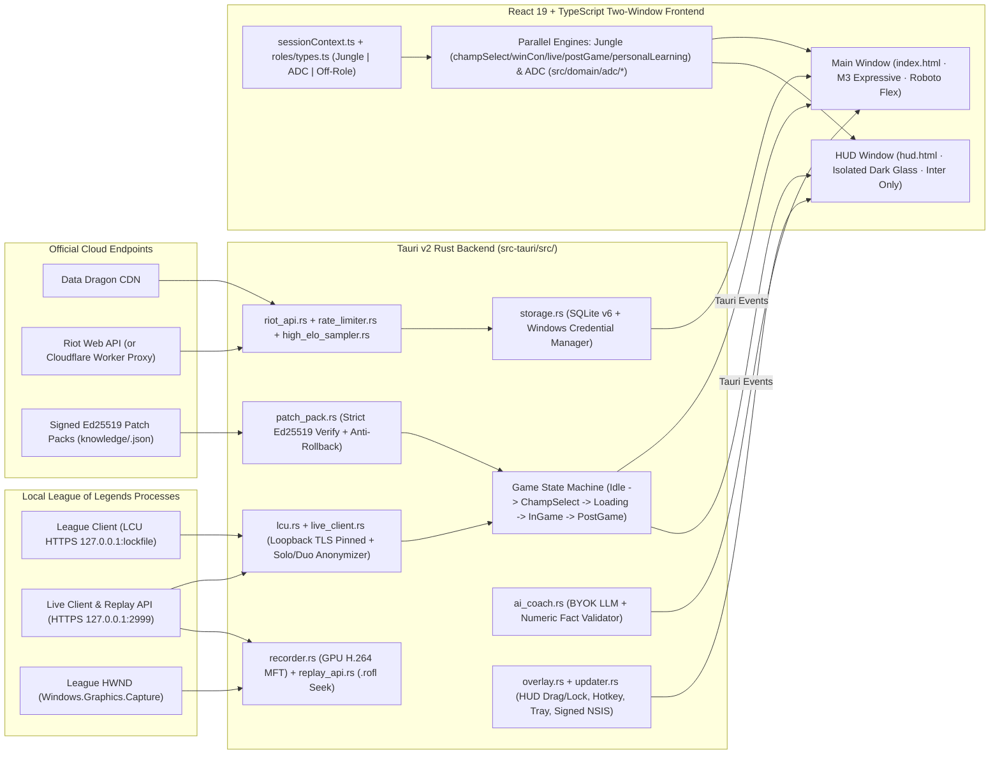

# System Architecture — BetterJungler (`v2.2.0`)

## 1. High-Level Two-Window Architecture

## 2. Two-Window CSS & Bundle Separation

Vite (`vite.config.ts`) builds two independent HTML entrypoints:
- **`index.html` → `src/main.tsx` → `src/App.tsx`**: Loads `@fontsource-variable/roboto-flex` and `src/styles/m3-expressive.css`, rendering the M3 Expressive desktop companion (`M3NavRail`, `M3TopAppBar` with aligned `32px` `SummonerProfilePill`, stacked Post-Game match cards → detail subpages, and stacked Settings category cards → modular subpages under `src/components/settings/`).
- **`hud.html` → `src/hudMain.tsx` → `src/HudApp.tsx`**: Loads `@fontsource-variable/inter` and `src/styles/globals.css` exclusively so M3 Expressive rules and `Roboto Flex` never leak into the transparent full-monitor Windows overlay (`HudOverlayCanvas.tsx`). Per-widget `(enabled, xPct, yPct)` layout (`hudWidgets`), lock state (`hudLocked`), scale, opacity, monitor target, and hotkey (`Alt+J` default) sync via `overlay.rs` and `subscribeHudPreferences`.

## 3. Game State Machine & Multi-Role Routing

1. **Idle**: Displays Climb & Goals home metrics (ordered first above Champ Select), Pre-Queue Champion Pool & Rune Planner, Post-Game history, or Settings.
2. **ChampSelect**: LCU `lockfile` detected and `/lol-champ-select/v1/session` succeeds. Non-local/non-party names are masked (`Ally 1..5`, `Enemy 1..5`).
3. **Loading**: `127.0.0.1:2999` responds pre-`0:00` or Champ Select locks 10 picks. Unlocking Win Plan reveals clear pathing or Bot Lane wave/gank planning.
4. **InGame**: Polls `127.0.0.1:2999` and emits state snapshots to both windows with client-side clock interpolation (`useInterpolatedGameTime.ts`).
5. **PostGame**: Match completes, triggering debounced automated Match-V5 sync + timeline/LP refresh (`AutoPostGameSync`).

### Coached Role Precedence (`src/domain/sessionContext.ts` & `src/HudApp.tsx`)
Role detection cleanly isolates **Jungle (`jungle`)**, **ADC (`bottom`)**, and **Off-Role (`top` / `middle` / `utility`)**:
1. Explicit manual role switcher override (`manualRole`)
2. LCU `assignedPosition` when `autoDetectRole !== false` (`jungle` → `jungle`, `bottom` → `bottom`)
3. Post-lock summoner spell & champion heuristic (Smite `11` → Jungle; `Heal`/`Barrier`/`Cleanse` + catalogued ADC → ADC; non-coached lane → `off_role`)
4. Saved `settings.primaryRole` fallback (default `'jungle'`)

In-game Off-Role detection suppresses Smite, jungle items, skill order, builds, CS pace, and lane/jungle cues in both `LiveCoachView` and `HudOverlayCanvas`, surfacing global objective timers only (`OFF-ROLE · GLOBALS`).

## 4. Parallel Role-Isolated Coaching Engines

Jungle and ADC engines share pure primitives (`formatClock`, `formatChampionName`, Wilson confidence intervals, EWM shrinkage) **read-only**, keeping Jungle recommendations and benchmarks untouched:
- **Jungle Domain**: `src/data/jungleKnowledgePack.ts`, `src/domain/champSelectEngine.ts`, `src/domain/jungleRoutingEngine.ts`, `src/domain/winConditionEngine.ts`, `src/domain/liveCoachEngine.ts`, `src/domain/climbLadderEngine.ts`, `src/domain/postGameReviewEngine.ts`, `src/domain/personalLearningEngine.ts`.
- **ADC Domain (`src/domain/adc/`)**: `src/data/adcKnowledgePack.ts` (22 Patch `16.23.1` ADCs + verified item/perk allowlists), `adcDraftEngine.ts` (Support Synergy & `Likely` 2v2 matchup), `adcGamePlanEngine.ts` (`0:30` Level-2 plan, `2:15–2:55` gank window, `14:00` plates, `5:00` Dragon, Bot → Mid swap), `adcLiveEngine.ts`, `adcBenchmarks.ts`, `adcKpis.ts`, `adcDetectors.ts`, and `adcPostGameEngine.ts`.
- **AI Coach & Grounding (`ai_coach.rs`, `aiFactValidator.ts`, `aiResponseCache.ts`)**: Optional BYOK Gemini, OpenAI, or loopback Ollama integration with `429`/`402` diagnostics, curated presets, unit-scoped numeric & cross-role claim validation, and persistent cache keys.

## 5. Local SQLite Schema (`PRAGMA user_version = 6`)

`storage.rs` manages schema migrations cleanly through `v6`:
- `settings`: JSON configuration (account/proxy, `primaryRole`/`secondaryRole`/`autoDetectRole`, overlay bounds & drag coords `hud_x`/`hud_y`/`hud_locked`, WGC recording prefs, AI Coach config).
- `ddragon_cache` & `patch_pack_cache`: Hydrated champion/item catalogs and Ed25519-verified patch packs (`knowledge/<patch>.json` supporting `objective_timings`, `smite_thresholds`, `meta_tier_overrides`, and `role_benchmarks.bottom`).
- `match_details_cache`, `matches_fact`, `match_metrics`: Normalized Match-V5 details & timelines including normalized `role` (`JUNGLE` / `BOTTOM` / `TOP` / `MIDDLE` / `UTILITY`), `lane_opponent_gold_diff_15`, `damage_share_pct`, `deaths_pre_14`, `turret_plates_taken`, and `level_2_time_sec`.
- `mistake_hits` & `baselines`: Deterministic mistake hits (`JUNGLE` and `BOTTOM` queried independently via `load_personal_learning_summary_for_role`).
- `climb_goals_v2`: Active/completed goals scoped by `role` (`jungle` | `bottom`) with atomic `set_focus_goal` transactions.
- `recordings` & `recording_sync_points`: Fragmented MP4 paths, byte sizes, pinned status, and monotonic clock offsets.
- `meta_snapshots`: Cached high-elo jungle Match-V5 meta samples.

## 6. Security Boundaries

- **Credentials (`keyring` Windows Credential Manager)**: Both `riot_api_key` and `ai_api_key` are stored under service `"betterjungler"`, sanitized on entry, and never persisted in plaintext SQLite or exposed in IPC responses/logs.
- **Loopback TLS Pinning**: Only `lcu.rs`, `live_client.rs`, and `replay_api.rs` accept Riot's bundled self-signed certificate (`src-tauri/certs/riotgames.pem`), asserting `host == 127.0.0.1` (`loopback_only`). External HTTPS clients enforce standard certificate validation and HTTPS-only proxy origin validation (`ai_coach.rs` also restricts Ollama endpoints to loopback).
- **Ed25519 Signed Artifacts**: Hot-swapped patch packs (`patch_pack.rs`) verify strict length-prefixed canonical bytes with anti-rollback checks, and Tauri v2 updates (`updater.rs`) verify installer signatures against the pinned public key while gating installs outside active gameplay.
- **Scoped Asset Protocol**: `tauri.conf.json` restricts media streaming strictly to `$APPDATA/recordings/**`.

See also: [ADR 0001](adr/0001-tauri-v2-desktop-overlay.md), [ADR 0002](adr/0002-deterministic-engine-and-hybrid-meta.md), [ADR 0003](adr/0003-signed-patch-packs-and-grounded-ai.md), [ADR 0004](adr/0004-two-window-m3-expressive-and-multi-role-core.md).
