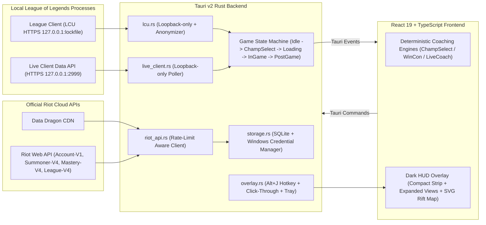

# System Architecture — BetterJungler

## 1. High-Level Architecture

## 2. Game State Machine
1. **Idle**: Neither Champ Select nor Active Game is open. Displays summoner profile, simulation mode, or settings.
2. **ChampSelect**: LCU `lockfile` detected and `/lol-champ-select/v1/session` returns 200. Enforces Ranked Solo/Duo anonymity masking and emits draft updates.
3. **Loading**: Live Client Data API `127.0.0.1:2999` responds with loading/pre-0:00 state or Champ Select locked in transitioning to match.
4. **InGame**: Live Client Data API returns active player and game clock. Emits live snapshot every 1.5s to drive adaptive builds, objective windows, and compliant macro cues.
5. **PostGame**: Active game ended; transitions back to `PostGame` / `Idle` (ready for Milestone 2 Match-V5 timeline fetch).

## 3. Local SQLite Schema (`betterjungler.db`)
- `settings`: Key-value JSON configuration (region, Riot ID, install path, HUD opacity/hotkey, optional BYOK AI coach config).
- `ddragon_cache`: Cached patch version and metadata timestamps.
- `match_details_cache` & `match_summaries`: Cached Match-V5 + Timeline payloads and rolling jungle KPI summaries.
- `climb_goals_v2`: Active and completed division improvement goals (auto-suggested bottlenecks & custom goals).
- `meta_snapshots`: Cached Challenger/GM Match-V5 jungle meta sample snapshots.

## 4. Security Boundaries
- **API Keys**: Stored via `keyring` crate in Windows Credential Manager (`service = "betterjungler"`, `user = "riot_api_key"`). Never logged or returned in plaintext IPC responses.
- **Loopback TLS Guard**: Only the dedicated local client (`lcu.rs`, `live_client.rs`) allows Riot's self-signed localhost certificate, and every request helper asserts `url.host_str() == Some("127.0.0.1")`. External HTTPS requests to `api.riotgames.com` and `ddragon.leagueoflegends.com` always enforce full standard TLS verification.
